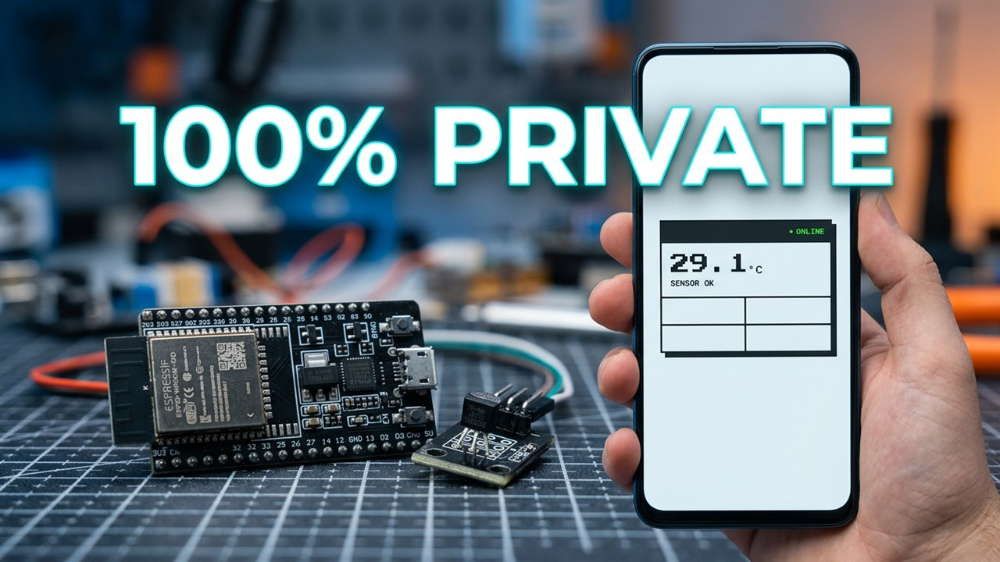
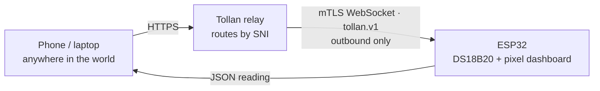

<div align="center">



# 🌡️ ThermoGhost

**Your own ESP32 temperature sensor, readable from anywhere on the planet — no port forwarding, no VPN, no cloud database.**

<!-- TODO: swap the channel link for the video URL once the real build is published -->
[](https://www.youtube.com/@angeldev0)
[](LICENSE)
[](https://espressif.com)
[](https://tollan.ie)
[](https://github.com/4ngel2769/ThermoGhost/stargazers)

</div>

---

A €10 temperature sensor on your bedside table. The board dials **out** to a
relay, holds an encrypted tunnel open, and serves a tiny dashboard plus a JSON
API. Open the URL from a phone on mobile data and the reading is there.

The board is the whole server. There is no database, no dashboard service, no
monthly bill and no cloud account holding your data.

## How it works



The board opens the tunnel **itself** and keeps it open, so:

- **No inbound ports.** Your router never sees a forwarded port.
- **No static IP.** Works behind NAT *and* CGNAT.
- **Per-device identity.** Every board has its own mTLS certificate.

### Why not just port-forward it?

|  | Port forwarding | VPN (Tailscale / WireGuard) | **ThermoGhost** |
|---|---|---|---|
| Router changes | Yes — forward a port | No | **No** |
| Public IP needed | Yes | No | **No** |
| Works behind CGNAT | No | Yes | **Yes** |
| Software needed by the visitor | Nothing | VPN client | **Nothing — it's a URL** |
| Public HTTPS URL | Possible | No (internal DNS) | **Yes** |
| Per-device identity | No — one open port | Yes | **Yes — one cert per board** |

---

## 🚀 Quick start

```bash
# 1. get the code
git clone https://github.com/4ngel2769/ThermoGhost.git
cd ThermoGhost

# 2. add the TollanAgent library (it is NOT in this repo — it is proprietary
#    and ships inside your own device bundle; see lib/README.md)
#    unzip your bundle, then:  cp -r <bundle>/TollanAgent lib/

# 3. credentials
cp src/secrets.h.example src/secrets.h      # edit: WIFI_SSID / WIFI_PASS
cp <your-bundle>/tollan_config.h src/        # paste-ready — keep it secret

# 4. build + flash
pio run -e esp32dev -t upload                # or -e esp32s2mini / -e esp32c3
pio device monitor -b 115200
```

Watch the serial console for:

```
wifi ok, ip=192.168.1.42
tollan: enrollment bundle — the board makes its own key on first boot
tollan: cert renewal enabled
tollan state -> connected
```

Then open your route in a browser.

> **New to Tollan?** You need a free account and a device bundle.
> [tollan.ie](https://tollan.ie) → register a device with the **ESP32**
> architecture → **Build bundle** → download it. The bundle contains your
> `tollan_config.h`, the relay CA and the TollanAgent library. The free tier
> (1 device, 2 routes, 5 GB) is plenty for this project.

---

## 🔌 Hardware

| Part | Why | ~Cost |
|---|---|---|
| ESP32 DevKit / S2 Mini / C3 | The brain **and** the server | €4 – €8 |
| DS18B20 module (`S` / `V` / `G`) | Temperature, ±0.5 °C | €2 – €4 |
| 3 × female-to-female Dupont | VCC / GND / signal | €1 |
| Micro-USB data cable | Flashing + power | €2 |
| 3D-printed case | Snug home for the board | ~€1 of filament |

**Total: roughly €10 and an afternoon.**

### Wiring

Three wires, on **GPIO 12**:

```
   ESP32 DevKit                    DS18B20 module
  ┌────────────┐                 ┌────────────────┐
  │  3V3       ├─────────────────┤ VCC   (red)    │
  │  GND       ├─────────────────┤ GND   (black)  │
  │  IO12 (D2) ├─────────────────┤ S/DQ (yellow)  │
  └────────────┘                 └────────────────┘
```

| DS18B20 module | ESP32 |
|---|---|
| `VCC` | `3V3` — **not** 5V |
| `GND` | `GND` |
| `S` (signal) | `GPIO 12` |

> **No resistor needed.** The 4.7 kΩ pull-up that a bare TO-92 sensor needs
> is already on the breakout module's PCB. If you use a loose TO-92 instead,
> add a 4.7 kΩ resistor between `DQ` and `3V3` or the reading will fail with
> `sensor_read_failed`.

> [!WARNING]
> **GPIO 12 is a strapping pin (MTDI).** It sets the flash voltage at boot
> (high = 1.8 V, low = 3.3 V), and the module's pull-up holds the line high
> at reset. Most DevKit boards boot fine. If yours hangs at boot, move the
> signal wire to **GPIO 13** and build with `-DSENSOR_PIN=13` — no source
> change needed.

### The case

The build uses the **ESP32 DevKit Case** by
[runesblog.com](https://www.runesblog.com) — pick the *"Tall lid for sensors
and wires"* print profile (0.2 mm layer, 2 walls, 15 % infill, ~49 min).

[](https://makerworld.com/en/models/2180476-esp32-devkit-case-nice-and-sturdy)

[Download it on MakerWorld →](https://makerworld.com/en/models/2180476-esp32-devkit-case-nice-and-sturdy)

The model is by its author and is **not** redistributed here — grab it from
MakerWorld, where it also comes in C3 Supermini and external-antenna
variants. Small clearance tweaks may be needed depending on your DevKit
revision.

---

## 📟 The dashboard

`GET /` serves a tiny pixel-art page: the temperature, the room name, your
local IP, Wi-Fi signal strength, uptime and a link to the API. It polls
itself every 3 seconds.

The same board serves both a human page and a machine API:

| Route | Returns |
|---|---|
| `GET /api` | JSON reading |
| `GET /json` | alias for `/api` |
| `GET /` | the dashboard (for browsers) |
| `GET /favicon.ico` | `204 No Content` |

```json
{
  "room": "my_bedroom",
  "tempC": 21.6,
  "tsMs": 123456,
  "ip": "192.168.1.42",
  "rssi": -58
}
```

- `tempC` — degrees Celsius
- `humidity` — only with DHT22 / DHT11
- `tsMs` — board uptime in milliseconds (there is no RTC on the board)
- `error` — present instead of a reading if the sensor could not be read
- Always HTTP `200`, so a poller can parse the body and inspect `error`

Both routes also work on the local network, on the board's own IP — handy
while you are still on the bench.

### More rooms

Each board is its own device with its own certificate. To add a second room:
register a second device, change `ROOM_ID`, flash, add a route. The room id
is echoed in every response so a poller always knows which sensor answered.

You can also override everything without touching the source:

```ini
[env:esp32dev]
board = esp32dev
build_flags =
    -DSENSOR_PIN=13 -DROOM_ID='"my_bedroom"'
```

---

## 🔐 Security model

Worth reading once, because "it runs on my hardware" and "nobody can see my
data" are two different claims.

**What is true:**

- The device key is generated **on the chip** and never leaves it. The bundle
  carries a one-time enrolment token, not a private key.
- The relay↔board hop is **mutual TLS** end-to-end, with a certificate per
  board. Revoke a device in the console and its tunnel drops within seconds.
- **No inbound ports**, so there is nothing to brute-force.
- Nothing is stored: no database, no account, no history. The reading exists
  in the browser tab you opened it in.
- Your Wi-Fi credentials and device key never go to the relay.

**What the relay can see:** the board speaks plain HTTP, and console
subdomains use **terminate mode** — the relay ends the visitor's TLS
connection and forwards the request to the board over the mTLS tunnel. So on
that leg the relay can read the request in transit, including the reading.
It cannot read the device key, and it stores nothing.

**If that matters to you:** put an IP allowlist or basic auth on the route —
both are enforced at the edge — or use a **passthrough** route, where the
relay routes by SNI without decrypting and your board terminates TLS itself.
Passthrough is the genuinely zero-knowledge setup, and it means running your
own certificate on the ESP32.

---

## ⏳ Lifetime

Device certificates are valid for **90 days**. With `TOLLAN_RENEW_URL` set
(the current bundles include it, and this sketch wires it up), the board
renews its own certificate about 30 days before expiry and keeps the renewed
identity in flash — no action needed, as long as the board is powered on
sometime during those last 30 days.

The serial console tells you at boot which features are live:

```
tollan: enrollment bundle — the board makes its own key on first boot
tollan: cert renewal enabled
tollan: health check-in enabled
```

## 📏 Known limit: the 1600-byte frame ceiling

The TollanAgent library stages an inbound WebSocket frame in a fixed
**1600-byte** receive buffer, inside the precompiled archive. A request that
does not fit is dropped and the tunnel resets with `oversize request —
dropping`.

- `curl /api` sends a small request — always fine.
- A browser `GET /` sends ~700–1200 B of headers plus the relay's forwarded
  headers — usually fine, but the margin is thin.

`cfg.maxFrameBytes` can only *lower* this ceiling, never raise it; the
buffer is inside the shipped binary. If the dashboard loads for you but
sometimes doesn't, this is why.

---

## 🧰 Troubleshooting

<details>
<summary><b>Build fails</b></summary>

| Symptom | Fix |
|---|---|
| `TollanAgent.h: No such file` | The library is not in `lib/`. Unzip your device bundle and copy `TollanAgent/` in. |
| `undefined reference to tollan::TollanAgent::begin` | The precompiled archive isn't linked. Check `lib/TollanAgent/` exists and that the `-L` path in `platformio.ini` matches your chip. See [`lib/README.md`](lib/README.md). |
| `'DEVICE_CERT' was not declared in this scope` | Your bundle uses enrolment but the sketch was built against an older library. Update the library (0.3.0+). |
| `tollan: bundle uses enrollment but this library has no enroll support` | Library older than 0.3.0. Re-download your bundle. |
</details>

<details>
<summary><b>Board won't connect</b></summary>

| Symptom | Fix |
|---|---|
| `tollan state -> connected` never appears | Wrong relay host/port, or no route yet. Use the bundle's `TOLLAN_RELAY_HOST` / `TOLLAN_RELAY_PORT` verbatim. |
| `tollan state -> terminal (version mismatch)` | The library doesn't match the relay. Use the library from your own bundle. |
| mbedTLS `-30592` (fatal alert) | Wrong relay host or port. |
| mbedTLS `-9984` (certificate verification failed) | The clock wasn't synced — the board booted near 1970. `syncClock` is on by default; make sure NTP is reachable. |
| `tollan: no credentials found in tollan_config.h` | The bundle's `tollan_config.h` isn't in `src/`. |
</details>

<details>
<summary><b>Sensor and hardware</b></summary>

| Symptom | Fix |
|---|---|
| `{"error":"sensor_read_failed"}` | No sensor on the bus. Check the wiring; a bare TO-92 needs an external 4.7 kΩ pull-up, a module has it on board. |
| Board hangs at boot | GPIO 12 is a strapping pin. Move the signal wire to GPIO 13 (`-DSENSOR_PIN=13`). |
| Reading is 1–2 °C too high | The ESP32's regulator runs warm. Keep the sensor head away from it, near a vent. |
</details>

<details>
<summary><b>Runtime</b></summary>

| Symptom | Fix |
|---|---|
| `curl /api` works but the browser page never loads | The request exceeded the 1600 B frame ceiling. |
| Works, then dies after ~90 days | Certificate renewal isn't enabled. Check for `tollan: cert renewal enabled` in the boot log. |
| Dashboard says `OFFLINE` | The board is not connected — check the serial console and the route in the console. |
</details>

---

## 📁 Repository layout

```
ThermoGhost/
├─ src/
│  ├─ main.cpp              firmware: TollanAgent handler mode + sensor + JSON API
│  ├─ web_page.h            the pixel-art dashboard (PROGMEM, ~1 kB)
│  ├─ secrets.h.example     → copy to secrets.h, add your WiFi
│  └─ tollan_config.h.example  → shape of the bundle's config
├─ docs/
│  └─ hero.jpg              the build thumbnail
├─ lib/
│  └─ README.md             how to install the proprietary TollanAgent library
├─ platformio.ini           build configs for ESP32 / S2 / C3
└─ LICENSE                  MIT, for this repo's code only
```

`lib/TollanAgent/`, `src/secrets.h` and `src/tollan_config.h` are
gitignored — they are either proprietary, secret, or both.

---

## 🙏 Credits

- **[Tollan](https://tollan.ie)** — the tunnel, the relay and the
  `TollanAgent` ESP32 library. Applied AI EdgeTech Limited.
- **[runesblog.com](https://www.runesblog.com)** — the ESP32 DevKit Case
  on [MakerWorld](https://makerworld.com/en/models/2180476-esp32-devkit-case-nice-and-sturdy).
  Design and print files by the author.
- **Espressif** — the ESP32.

## 📄 License

[MIT](LICENSE) — for this repository's own code.

The `TollanAgent` library is **not** part of this repository. It is
proprietary, licensed only for use with the Tollan service, and ships inside
your own device bundle.
